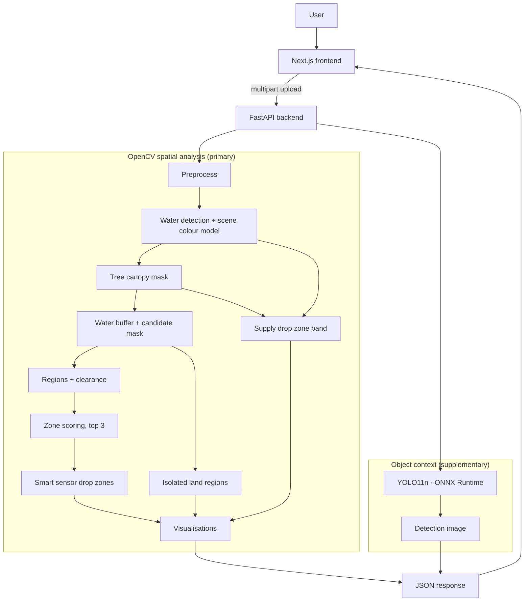

# AASRA — AI-Assisted Relief Area Identification

**Computer-vision decision support for aerial flood imagery.**
From one aerial or drone photograph, AASRA detects water, separates open land
from tree canopy, and marks two separate results — all as geometry measured in
image pixels:

- **Probable Smart Sensor Drop Zones** (purple circles) — open land where
  flood sensors or cameras could be dropped.
- **Probable Supply Drop Zone** (green band) — open land between an inner
  and an outer margin drawn around the detected water, so supplies land near
  the water's edge.

A separate object detector adds visible-object context and never changes
those results.

AASRA does not detect flood victims, does not assess landing, drop, access or
structural safety, and makes no operational decision. It produces candidates
for trained people to verify. See [Limitations](#limitations).

---

## Contents

- [What it does](#what-it-does)
- [Results](#results)
- [How it works](#how-it-works)
- [Architecture](#architecture)
- [Technology](#technology)
- [Project structure](#project-structure)
- [Getting started](#getting-started)
- [Testing](#testing)
- [API](#api)
- [Deployment](#deployment)
- [Limitations](#limitations)
- [Disclaimer](#disclaimer)

## What it does

1. Accepts one JPG/PNG aerial image (≤ 15 MB) and resizes it so the longest
   edge is at most 1024 px.
2. Detects water with a documented, multi-cue OpenCV heuristic, then checks
   it against **this image's own water colour** so pale concrete, roofs and
   pale lots are not read as water (no trained model).
3. Masks **tree canopy** (textured vegetation): nothing dropped from the air
   reaches the ground through it, so no zone is placed on it.
4. Widens the water by an 18 px buffer; open land outside it is candidate
   land. Connected candidate regions are measured and ranked 0–100.
5. For each of the top three regions, takes its highest-clearance pixel and
   computes the largest circle around it that stays on that region's
   candidate land — a **Probable Smart Sensor Drop Zone** (purple).
6. Draws an **inner margin** 18 px and an **outer margin** 60 px back from the
   detected water's edge; open land between them is the **Probable Supply
   Drop Zone** (green), split into connected segments.
7. Reports potentially isolated land regions (land cut off by water).
8. Runs YOLO11n (ONNX Runtime) separately to count visible people and
   vehicles.
9. Returns everything — numbers, explanations and annotated images
   (combined, sensor-only and supply-only views) — to a Next.js interface.

## Results

| Result | Shape | Meaning |
|---|---|---|
| Probable Smart Sensor Drop Zone | purple circle | largest circle of candidate land around a ranked region's highest-clearance point |
| Probable Supply Drop Zone | green band | open land between the inner and outer margins around detected water |
| Inner margin | solid line | 18 px from the water's edge (the standoff) |
| Outer margin | dashed line | 60 px from the water's edge (how far back the band reaches) |

The two results are independent: the interface shows them together
(Combined) and each on its own. No output describes a location as safe,
guaranteed, or a rescue or landing zone; the interface only uses those words
to say what AASRA does *not* claim.

## How it works

| Stage | Module | Output |
|---|---|---|
| Preprocess | `preprocessing.py` | resized display copy + blurred/CLAHE analysis copy |
| Water | `water_detection.py` | water mask (cues + per-scene colour model) |
| Canopy | `canopy.py` | tree-canopy mask |
| Buffer + candidates | `candidate_mask.py` | water buffer, candidate mask (open land only) |
| Regions | `region_analysis.py` | components, max-clearance point, openness |
| Isolation | `isolated_regions.py` | isolated land regions (reported only) |
| Scoring | `scoring.py` | top 3 zones, 0–100 region score |
| Sensor drop zones | `storage_zones.py` | circle radius per ranked zone |
| Supply drop zone | `supply_zones.py` | band between the margins, segments |
| Visualisation | `visualization.py` | seven PNGs on the same pixel grid |
| Object context | `ai_detection.py` | YOLO11n detections (independent) |

**Sensor zone radius.** A pixel is valid when it belongs to the zone's
candidate component and is outside the water buffer. With `d` the exact
distance from the centre to the nearest invalid pixel or the image edge,
`radius = min(ceil(d) − 1 − 4, 180)`, then every pixel of the circle is
checked against the mask. Radii under 12 px are reported as not viable.

**Supply band.** With `d(p)` the distance from land pixel `p` to the nearest
water pixel, the band is open land (not canopy) with `18 ≤ d(p) ≤ 60`,
cleaned and split into connected segments, largest first.

**Scene colour model.** The most water-like pixels are clustered in Lab; the
largest cluster is the scene's water colour. Clusters much brighter than it
(concrete, roofs) are rejected and pixels closer to them lose their water
evidence. On the bundled Pakistan photo this cut detected water from 64.9 % to
38.1 % — the concrete pad, roofs and walls are land again.

Full formulas: [`docs/pipeline.md`](docs/pipeline.md).

## Architecture



The AI branch reads the same resized image and writes only `ai` and
`images.ai_context`. If it is disabled (`AI_ENABLED=false`) or fails, the
response reports `analysis_mode.ai = false` and every other field is
unchanged.

## Technology

| Backend | Version |
|---|---|
| Python | 3.13 |
| FastAPI / Uvicorn | 0.115.6 / 0.34.0 |
| OpenCV (`opencv-python-headless`) | 4.10.0.84 |
| NumPy / Pillow | 2.1.3 / 11.0.0 |
| ONNX Runtime | 1.29.0 |

The model ships in the repository as
`backend/app/services/weights/yolo11n.onnx` (~10 MB). Nothing is downloaded
at runtime. (The optional ultralytics parity check in `tests/verify_onnx.py`
needs a local `yolo11n.pt`; it is not committed and the check skips without
it.)

| Frontend | Version |
|---|---|
| Next.js (App Router) | 16.3.5 |
| React | 19.2.8 |
| TypeScript / Tailwind CSS | 5 / 4 |
| lucide-react | 1.45 |

## Project structure

```
AASRA/
├── backend/
│   ├── app/
│   │   ├── main.py              FastAPI: GET /health, POST /api/analyze
│   │   ├── config.py            every threshold, documented inline
│   │   ├── pipeline.py          runs the stages, builds the response
│   │   └── services/
│   │       ├── preprocessing.py
│   │       ├── water_detection.py    cues + per-scene colour model
│   │       ├── canopy.py             tree-canopy mask
│   │       ├── candidate_mask.py     water buffer + candidate mask
│   │       ├── region_analysis.py
│   │       ├── isolated_regions.py
│   │       ├── scoring.py
│   │       ├── storage_zones.py      sensor drop zone radius
│   │       ├── supply_zones.py       supply drop zone band
│   │       ├── visualization.py
│   │       ├── ai_detection.py       YOLO11n on ONNX Runtime
│   │       └── weights/yolo11n.onnx
│   ├── tests/
│   │   ├── test_storage_zones.py     geometry, band, canopy, colour-model tests
│   │   ├── smoke_test.py             end-to-end pipeline run
│   │   └── verify_onnx.py            AI module check
│   └── requirements.txt
├── frontend/
│   ├── app/                     page, layout, design tokens
│   ├── components/              landing, upload, stage viewer, sensor/supply cards
│   ├── lib/  types/             API client, formatting, response types
│   ├── public/imagery/          public-domain flood photographs + CREDITS.md
│   └── e2e/                     playwright-cli end-to-end checks
├── docs/                        api, pipeline, design, PRD, deployment
└── render.yaml                  Render Blueprint (backend)
```

## Getting started

**Backend** (Python 3.13):

```bash
cd backend
python -m venv .venv
# Windows: .venv\Scripts\activate    Linux/macOS: source .venv/bin/activate
pip install -r requirements.txt
uvicorn app.main:app --reload --port 8000
```

Check `http://127.0.0.1:8000/health`; API docs at `/docs`.

**Frontend** (Node.js 20+):

```bash
cd frontend
npm install
cp .env.example .env.local      # NEXT_PUBLIC_API_URL=http://localhost:8000
npm run dev                     # http://localhost:3000
```

Open `http://localhost:3000`, choose an image or one of the two sample
images, and select **Run analysis**. No API keys are needed anywhere.

**Windows, one click:** double-click `start-local.bat` in the project root. It
creates the backend environment, installs both sides on the first run, starts
the backend (`:8000`) and frontend (`:3000`) in two windows and opens the
browser. Close the two windows to stop.

## Testing

```bash
cd backend
python -m tests.test_storage_zones        # geometry, band, canopy and colour-model tests
python -m tests.smoke_test                # synthetic scene, writes tests/output/
python -m tests.smoke_test path/to/image.jpg
python -m tests.verify_onnx               # AI module

cd ../frontend
npx tsc --noEmit && npm run lint && npm run build

# End-to-end (backend on :8000 and frontend on :3000 running)
cd e2e
python make_fixtures.py                   # use the backend venv's Python
playwright-cli open http://localhost:3000
playwright-cli run-code --filename=aasra.e2e.js
```

## API

| Method | Path | Purpose |
|---|---|---|
| `GET` | `/health` | liveness, limits, AI availability |
| `POST` | `/api/analyze` | multipart field `image` → full analysis |

The response contains `metrics`, `zones`, `sensor_zones`, `sensor_analysis`,
`supply_zone` (margins, area and segments), `isolated_regions`, `ai`,
`images`, `warnings` and `notice`. Errors use
`{ "success": false, "error": { "code", "message" } }`. Full reference with a
real response: [`docs/api.md`](docs/api.md).

## Deployment

Backend on Render (`render.yaml`), frontend on Vercel. Set `CORS_ORIGINS` on
the backend and `NEXT_PUBLIC_API_URL` on the frontend. Details, memory notes
and the AI kill switch: [`docs/deployment.md`](docs/deployment.md).

## Limitations

- Image analysis only: no elevation, terrain, surface, weather or map data.
- Distances are processed-image pixels. Without a known ground scale they are
  not metres, and the margins and zone sizes on the ground are unknown.
- Water detection is a hand-tuned heuristic. The scene colour model removes
  most pale concrete and roofs, but grey asphalt car parks and dark-grey roofs
  can still be read as water when the floodwater is itself grey (bundled
  Tennessee photo), and deep shadow, sky in oblique photos and dark,
  low-contrast scenes can too. Every downstream result inherits the water
  mask; a trained segmentation model is the real fix.
- Tree canopy is detected from colour and texture. Hedges and grass verges
  next to roads can be misread; images that are mostly woodland yield little
  or no drop zone.
- Oblique photographs distort distances; near-vertical imagery works best.
- A sensor or supply drop zone is open land at a measured distance from
  detected water in this image — nothing more. Buildings, vehicles, power
  lines, slopes and people inside it are not assessed.
- Scores are transparent ranking heuristics, not validated measures.
- YOLO11n was trained on everyday photographs; on aerial imagery it misses
  many objects (0 detections on 3 of the 4 bundled photos). Its output never
  changes any zone.
- No labelled flood dataset was used for evaluation; no accuracy figure is
  claimed.

## Disclaimer

AASRA is an academic computer-vision decision-support prototype. It must not
be the sole basis for emergency, aviation, supply-drop or rescue decisions.
Every output needs verification by trained personnel.

Imagery in `frontend/public/imagery/` is U.S. government work in the public
domain; see its `CREDITS.md`.

No license file is included; all rights are reserved by the author.
